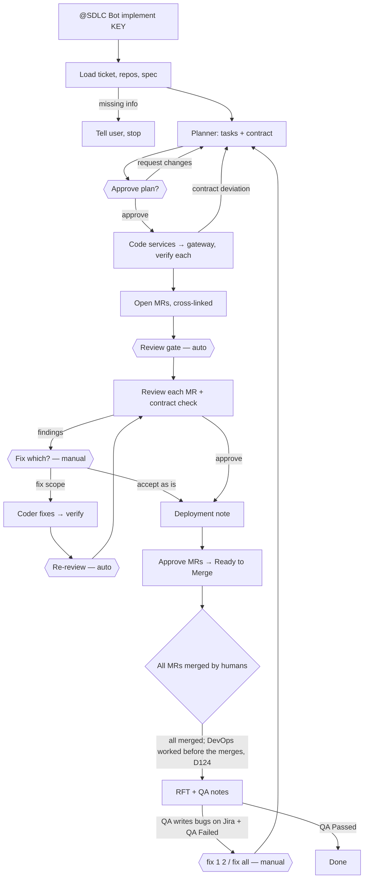

# AI SDLC Agent Pipeline — Design

> **Note (D204):** Microsoft Teams support was removed; the terminal (`pipeline cli`) is the only front-end. Mentions of Teams, the Agents Playground and the free-text intent agent below are design history.

**Status:** Draft v0.4 (demo scope) · Shareable with the team
**Goal:** let the team hand Jira tickets to AI agents from a Microsoft Teams chat, and get reviewed, deploy-documented, QA-ready GitLab MRs across our microservice repos, while humans keep control of every important decision.

---

## 1. Summary

| Stage | Today | With the pipeline |
|---|---|---|
| Choose a ticket for the AI | — | **Human** in Teams: `@SDLC Bot implement DEMO-12` |
| Work out which repos change and how they connect | Developer | **Planner Agent** (per-repo tasks + interface contract) |
| Approve the approach | — | **Human**: "Approve plan" button |
| Code each repo, tests, sanity check | Developer | **Coder Agent**, one run per repo, following that repo's standards |
| Raise MRs | Developer | **Orchestrator** (one MR per repo, cross-linked) |
| Review | Reviewer | **Reviewer Agent** per repo + cross-repo contract check (starts automatically) |
| Decide which findings to fix | Reviewer / Developer | **Human**: "Fix blockers / Fix all / Accept" buttons |
| Fix | Developer | **Coder Agent** → automatic re-review |
| Approve | Reviewer | **Reviewer Agent** approves; humans notified in Teams |
| Merge | Developer | **Human** in GitLab |
| DevOps needs + deployment doc | Developer / Lead | **Deployment Agent** (one note per ticket, deploy order) |
| Infra / env / migration setup | DevOps | **Human** → "DevOps done" |
| QA handoff (cURL / test steps) | Developer | **Deployment Agent** after merge |
| QA bugs → fixes | Developer | **Human** triggers "Fix bugs" → agents |
| Jira status changes | Everyone | **Orchestrator** |
| QA Passed | QA | **Human** |

Everything the agents do is visible in the Teams thread for the ticket, in Jira comments (audit trail), and in MR threads and commits.

---

## 2. Context: our architecture

- **API gateway** (Node + Express): public routes, auth, request validation, calls internal services over **REST**, maps their errors.
- **Services** (Node + Express): business logic and DB operations, internal REST endpoints.
- **Frontend** (Vue.js): calls the gateway.

A typical backend ticket touches the gateway + one or more services, each with its **own** coding practices.

---

## 3. Design principles

1. **Humans steer from chat; agents do the work.** Every important decision (start, plan, what to fix, merge, DevOps, QA) is a human action in Teams, GitLab or Jira.
2. **Configurable steps.** Each step is either manual (waits for a human) or automatic, set in config, without code changes.
3. **Agents think, the orchestrator acts.** All Jira/GitLab/Teams writes are deterministic code; agents return structured JSON.
4. **Plan across repos, code per repo.** One planning step writes the interface contract; each repo is coded inside itself, where its own standards apply.
5. **The contract is the agreement** between gateway and services; deviations stop the line.
6. **A ticket moves as a set** of MRs, in a stated order.
7. **Jira remains the source of truth and audit trail**; Teams is the conversation.
8. **Separate identities:** Coder and Reviewer are different GitLab users.
9. **Written standards per repo:** `CLAUDE.md` / `AGENTS.md`, `REVIEW.md`, `DEPLOYMENT_TEMPLATE.md`.
10. **Bounded loops** with escalation to a human.

---

## 4. How it looks in Teams

A team channel (or group chat) with the **SDLC Bot**. Each ticket gets its own thread.

```
Kushal:     @SDLC Bot implement DEMO-12
SDLC Bot:   On it. Coder-A (Claude) picked up DEMO-12 "Weekly revenue recalculation".
            Repos: orders-service → api-gateway.
SDLC Bot:   📋 Plan ready                                   [card]
            orders-service: POST /internal/v1/revenue/recalculate …
            api-gateway:    POST /api/v1/revenue/recalculate → calls the above …
            Contract: 1 internal endpoint, 1 public endpoint, 3 error cases
            [Approve plan]  [Request changes]  [Stop]
Kushal:     (clicks Approve plan)
SDLC Bot:   Coding orders-service… ✅  Coding api-gateway… ✅
            MRs: orders-service !9 · api-gateway !14  (merge in this order)
            Reviewer-A started the review automatically.
SDLC Bot:   🔍 Review round 1: 1 blocker, 2 minor (1 contract finding)   [card]
            [Fix blockers]  [Fix major+]  [Fix all]  [Accept as is]  [Stop]
Kushal:     @SDLC Bot fix only the blockers please
SDLC Bot:   Understood as: fix DEMO-12 blockers. Coder-A working…
SDLC Bot:   Fixes pushed. Re-review… ✅ Approved. Deployment note attached.
            Ready to merge: orders-service !9, then api-gateway !14.
```

**Commands** (exact form; free text also works and is interpreted, with confirmation when unsure): `implement`, `approve plan`, `revise plan: <feedback>`, `review`, `fix [all|blockers|major+|<ids>]`, `accept`, `deploy-doc`, `devops-done`, `bug <KEY>: <text>`, `fix bugs`, `status`, `stop`, `retry`, `help`. Inside a ticket thread the ticket key can be omitted. Only allowlisted people can command the bot. QA and DevOps can also use `/bug`, `/devops-done` in Jira comments.

`@SDLC Bot status` lists every in-flight ticket, its stage, what it's waiting for, and which agents are busy.

---

## 5. Workflow and gates

### 5.1 Gates

| Step | Default | Options |
|---|---|---|
| Start work on a ticket | **Manual** (tag the bot) | Auto = pick up Jira tickets labelled `ai-ready` |
| Approve the plan | **Manual** (button) | Auto |
| Review after MRs are raised | Auto | Manual |
| Fix review findings | **Manual** (Fix blockers / major+ / all / Accept) | Auto (uses default scope) |
| Re-review after fixes | Auto | Manual |
| Deployment note | Auto | Manual |
| QA bugs → fix | **Manual** | Auto |
| Merge, DevOps done, QA Passed | Always human | — |

For a fully controlled demo every gate can be set to manual; relax them as trust grows.

### 5.2 Jira statuses

To Do → In Dev (planning, plan approval, coding) → Code Review → Changes Requested ↔ Code Review → Ready to Merge → Awaiting DevOps (if needed) → RFT → QA Failed ↔ … → QA Passed. **Needs Human** on limits, errors or ambiguity. The orchestrator moves statuses; humans keep QA Passed.

### 5.3 Flow



---

## 6. Architecture

- **Orchestrator** — Python + **LangGraph**. One graph run per ticket, checkpointed; gates and external waits are `interrupt()`s that resume when a command or event arrives.
- **Command bus** — one entry point for Teams messages and button clicks, CLI (`pipeline say "…"`, used during development and as a fallback), and Jira comment commands.
- **Teams bot** — built with Microsoft's Agents SDK; posts into one thread per ticket and uses **Adaptive Cards** for buttons. For the demo it runs against the **Microsoft 365 Agents Playground**, a local Teams-like emulator that needs no Microsoft 365 tenant. Real Teams is out of scope for now (D88).
- **Agent pool** — named slots (Coder-A/B/C, Reviewer-A/B, Deploy-A); each slot has a provider. Slots are held only while an agent runs; when all are busy, tickets queue.
- **Agent providers** — **Claude** (Claude Code via the Claude Agent SDK) or **Codex** (`codex exec`), per slot/role, subscription auth by default; API keys for team rollout.
- **Integrations** — Jira Cloud REST, GitLab REST (coder and reviewer identities), Google Docs/Drive API for specs.
- **Workspaces** — per ticket, one git worktree per repo on the same branch name.
- **State** — SQLite: LangGraph checkpoints + tracking tables (tickets, MRs, events, agent runs, commands, slots, chat threads). Postgres for rollout.

Why coding agents rather than plain LLM calls: writing code needs file tools, shell, context management and permissions; Claude Code and Codex already provide this.

---

## 7. Repos and the interface contract

- Repos come from the Jira **Repos** checkbox field (fallback `Repos:` line); never guessed.
- The **Planner** reads the ticket, the spec and all involved repos, and produces per-repo tasks, an **interface contract** (internal endpoints with JSON schemas, errors and internal auth; public gateway endpoints with validation and error mapping) and the order (services → gateway → frontend). It can stop with questions.
- The plan and contract are posted to Teams for approval; "Request changes" feeds your comments back to the planner.
- Coding happens per repo, in order, each receiving its task + the contract. Deviations → one replan → then a human.

---

## 8. Review and fixes

- Per-repo review with that repo's `REVIEW.md`, plus a cross-repo **contract check** (gateway calls = service endpoints; validation and error mapping consistent).
- Findings: inline on the right MR (reviewer identity), summary on Jira, a findings card in Teams.
- The fix gate lets a human choose: fix blockers / major+ / all / specific finding ids, **accept as is** (logged override), or stop.
- Fixes touch only affected repos; re-review is automatic by default; max 3 rounds.

---

## 9. Deployment note and QA handoff

After approval (and before formal MR approval, so it's covered): deterministic facts per repo (env vars, migrations, infra files, dependencies, queues, build-time frontend vars) + a written note:

0. Change set & order (merge/deploy order, compatibility) · 1. Environment variables · 2. DB migrations · 3. Infrastructure changes (per repo) · 4. Rollback, only for a repo with migrations (undo command, D123). Post-deploy checks and risk were dropped (D122). Migrations are never run by the pipeline: coders only write them (D123); DevOps runs them from the note.

Written right after the MRs are approved; attached to Jira (`.md` + a one-line comment pointing at it, D122) and summarised on a Teams card; nothing is added to the MRs (D121). After all MRs merge: DevOps needed → Awaiting DevOps → `devops-done` → RFT; otherwise RFT.

QA handoff: cURLs for the **gateway's public endpoints** (placeholders only), or click-through notes for Vue pages. Bugs via `bug …` in Teams or `/bug` in Jira; "Fix bugs" sends them through planning (affected repos only), coding and the same review loop.

---

## 10. Tech stack

| Layer | Choice |
|---|---|
| Language | Python 3.11+ (uv) |
| Orchestration | LangGraph (+ SQLite checkpointer) |
| Agents | Claude Agent SDK (Claude Code) or Codex CLI per slot; subscriptions for demo, API keys for rollout |
| Chat | Microsoft Agents SDK bot, Adaptive Cards; Microsoft 365 Agents Playground for local demo |
| Tracking DB | SQLite via SQLAlchemy Core → Postgres |
| Integrations | atlassian-python-api, python-gitlab, Google API client |
| Sandbox | git worktrees + Docker Compose |
| Agent-run checks | Jest/Mocha + Supertest + nock (backend), Vitest + build (+ Playwright) (frontend) |

---

## 11. Implementation phases

| Phase | Outcome |
|---|---|
| 0 | Each target repo agent-ready: `CLAUDE.md` + `AGENTS.md`, `REVIEW.md`, deployment template, sanity script |
| 1 | Scaffold, config, contracts, tracking DB, Jira/GitLab/Docs clients, multi-repo workspaces |
| 2 | Agent runner (Claude + Codex) and Planner Agent |
| 3 | Command bus + console chat, gates, agent pool, Coder Agent per repo, MRs: `pipeline say "implement DEMO-1"` → plan approval → MRs |
| 4 | **Teams bot** in the Agents Playground: commands, threads, cards, free-text commands, allowlist, status |
| 4b | **Conversational layer:** provider-swappable Chat LLM (Groq / OpenAI / Anthropic) that understands people and answers in plain language; two-part Jira comments (Summary + developer details); personas; `guide` |
| 5 | Reviewer Agent + contract check + fix gate + re-review, asked for by a human; numbered findings in a fixed format; `change` requests on open MRs |
| 6 | Deployment Agent, merge and DevOps waits |
| 7 | QA handoff, QA bug loop, Vue |
| 8 | Hardening, report, demo tooling, rollout docs |

For the demo, Phases 0–6 plus the cURL part of Phase 7 give a complete story.

---

### 11.1 How people work with it (target loop, D87)

1. "@SDLC Bot DEMO-10 is ready, can you implement it?" → plan on Jira + a short card in Teams.
2. "Looks good, please start" (or the button) → coding; progress in one card; problems are explained in chat and on Jira (the single source of truth); "@SDLC Bot guide DEMO-10: I updated the ticket, try again" steers a stuck step.
3. MRs posted in the group → "Reviewer, the MRs are ready, please review" → numbered findings in a fixed format on the MRs and Jira.
4. "Fix #1 and #3, #2 is fine because …" → coder fixes, pushes, "please review again" → "please check again" → "code review passed".
5. Own ideas or requirement changes while MRs are open: "change DEMO-10: …" → fixed on the same MRs (or re-planned) → re-review.
6. Deployment note (before merge) in the MR, in chat as a `.md` file and on Jira → humans merge → DevOps / QA.
7. QA bugs: "these are the bugs, please fix" → the same loop on new MRs.

The Chat LLM handles the talking; Claude/Codex do the work; every decision still passes the command bus and its gates.

## 12. Demo script (15 minutes)

1. Show a ticket (Repos = gateway + service, spec link) and the Teams chat.
2. `@SDLC Bot implement DEMO-2` → plan card → click **Request changes** with a small tweak → revised plan → **Approve plan**.
3. Watch progress messages; two MRs posted, review starts automatically.
4. Findings card (seeded catch + contract finding) → type "fix only the blockers" → bot shows its interpretation → fixes → auto re-review → approved; deployment note summary.
5. Merge both MRs in GitLab → Awaiting DevOps → **DevOps done** → RFT with gateway cURLs.
6. `@SDLC Bot status` and `pipeline report`: stages, rounds, which agents worked on what.

---

## 13. From demo to team rollout

| Area | Demo | Team |
|---|---|---|
| Chat | Agents Playground on a laptop | Agents Playground (real Teams out of scope, D88) |
| Accounts | Personal Jira + GitLab.com, 2nd GitLab user as reviewer | Bot users on company Jira and self-hosted GitLab |
| Agent auth | Personal Claude and Codex subscriptions | API keys, org billing |
| Runtime | Local machine | VM/container; agents in isolated containers |
| State | SQLite | Postgres |
| Secrets | `.env` | Secret manager |
| Access | You | Allowlist of team members; per-person audit via the commands table |

---

## 14. Risks and mitigations

| Risk | Mitigation |
|---|---|
| Vague tickets / wrong repos | Repos field required; spec + AC gate; planner can ask; human plan approval |
| Gateway and service drift | Contract; contract check in review; gateway tests mock from contract |
| Wrong fixes or over-fixing | Human chooses fix scope; overrides logged |
| Misread free-text commands | Exact commands as the core; interpreted commands echoed back; confirmation for risky verbs |
| Anyone in the channel triggering code changes | Allowlist; commands audited |
| Long waits in chat | Immediate acknowledgement, progress messages, `status` |
| Same-model blind spots | Reviewer slots on the other provider; human merge |
| Endless loops | Round limits → Needs Human |
| Cost / plan limits | Slots cap concurrency; run and cost caps; provider fallback |
| Teams tenant restrictions | Build and demo on the Playground only; real Teams out of scope (D88) |

---

## 15. Success metrics

Tickets reaching Ready to Merge without human code edits · plan revisions per ticket · review rounds · human overrides · lead time from `implement` to Ready to Merge · deployment notes accepted as-is · QA bugs per AI ticket · agent runs and cost per ticket.
